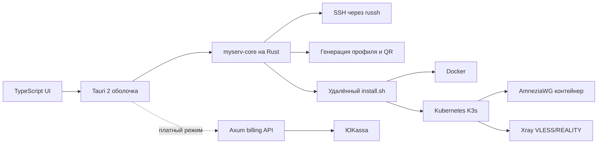

# MyServ: описание приложения и технологий

## Назначение

MyServ — клиентское приложение для настройки VPN-сервера, который принадлежит самому пользователю. Приложение не предоставляет общий VPN-сервис и не хранит пользовательский трафик. Пользователь самостоятельно арендует VPS у хостинга, передаёт приложению адрес и SSH-доступ, после чего MyServ проверяет сервер, устанавливает необходимые компоненты и создаёт конфигурацию для подключения.

В текущей Windows-сборке 0.1.4 включён бесплатный режим `free-preview`, поэтому экран оплаты и проверка лицензии пропускаются. В коммерческом режиме планируется разовая оплата 199 ₽ через ЮKassa. VPS оплачивается отдельно хостингу.

Приложение само не является VPN-клиентом: оно подготавливает сервер и выдаёт профиль. Полученный файл, QR-код или VLESS-ссылку нужно импортировать в совместимое приложение AmneziaWG или Xray-клиент.

## Возможности

Пользователь может:

- пройти краткую инструкцию по покупке чистого VPS;
- указать IPv4, SSH-порт, логин и пароль;
- подключиться к серверу без ручного ввода SSH-отпечатка;
- выбрать AmneziaWG 3.1 или Xray VLESS + REALITY;
- автоматически установить Docker, Kubernetes K3s и выбранный протокол;
- получить `.conf`, JSON, VLESS-ссылку и QR-код;
- повторить установку на том же сервере с сохранением существующих ключей.

Требования к VPS: Ubuntu 24.04 LTS, публичный IPv4, systemd, минимум 2 ГБ RAM, минимум 8 ГБ свободного места, доступ к `/dev/net/tun` для AmneziaWG и возможность открыть SSH и выбранный VPN-порт.

## Архитектура



Слои проекта:

| Слой | Каталог | Ответственность |
|---|---|---|
| Интерфейс | `apps/client/src` | Мастер настройки, формы, выбор протокола, отображение прогресса и экспорт файлов |
| Нативная оболочка | `apps/client/src-tauri` | Команды Tauri, жизненный цикл приложения, системные диалоги и состояние SSH-сеанса |
| Общее ядро | `crates/core` | SSH, проверка входных данных, генерация ключей и профилей, установка, лицензии |
| CLI | `crates/cli` | Диагностика и запуск операций из терминала |
| Платёжный сервис | `services/billing` | ЮKassa, SQLite, идемпотентность заказов и подпись лицензий |
| Инфраструктура | `infra` | Shell-установщик, Dockerfile, Kubernetes-манифест и запуск AmneziaWG |

## Общий код для Windows, Android и iOS

Приложение использует Tauri 2. Интерфейс написан на TypeScript, HTML и CSS, а критические операции выполняются в общем Rust-ядре. Это позволяет использовать одну реализацию SSH, генерации профилей, проверки сервера и установки на Windows, Android и iOS.

Платформенная часть отвечает только за системные функции: окно приложения, WebView, файловый диалог, открытие ссылки оплаты и сохранение экспортируемого файла. Android и iOS требуют отдельных SDK, подписей и приёмочных тестов на устройствах. Встроенный VPN-туннель в MyServ отсутствует.

Основные технологии клиента:

- Rust 2024 и Cargo workspace;
- Tauri 2;
- TypeScript, Vite и Vitest;
- `russh 0.65.1` для асинхронного SSH;
- `tokio` для асинхронных операций;
- `serde`/`serde_json` для безопасных структур данных;
- `zeroize` для очистки секретов из Rust-структур;
- `qrcode` для создания SVG QR-кода;
- `sha2`, `ed25519-dalek`, `x25519-dalek` и `rand` для привязок, лицензий и ключей.

## Как проходит настройка

1. Пользователь покупает чистый VPS и выбирает Ubuntu 24.04.
2. Вводит в приложении IP, SSH-порт, логин и пароль.
3. Приложение устанавливает SSH-соединение через `russh`. При первом подключении публичный ключ сервера сохраняется локально в `known-hosts`. При последующих подключениях несовпадение ключа блокирует операцию до авторизации.
4. Приложение запускает удалённую проверку `infra/preflight.sh`. Проверяются ОС, архитектура, RAM, свободное место, systemd, Python, занятые порты, Kubernetes и существующие Docker-контейнеры.
5. Пользователь выбирает протокол.
6. В бесплатной сборке 0.1.4 установка запускается сразу после подтверждения чистого VPS. В коммерческой сборке перед этим создаётся заказ, пользователь оплачивает 199 ₽, а billing API выдаёт подписанную лицензию.
7. Rust-ядро генерирует серверные и клиентские ключи, кодирует набор материалов и передаёт его через SSH в `infra/install.sh`.
8. Установщик ждёт освобождения блокировок `dpkg` до 600 секунд, устанавливает Docker, Docker Buildx, системные пакеты и запускает Docker.
9. Устанавливается одноузловой K3s. Бинарник K3s скачивается с GitHub и проверяется по SHA256.
10. Для AmneziaWG собирается контейнер из закреплённых upstream-коммитов. Для Xray скачивается официальный образ и проверяется JSON-конфигурация.
11. Kubernetes создаёт namespace `myserv`, Secret с конфигурацией и Deployment `tunnel` с одной репликой.
12. Приложение ждёт готовности Deployment, читает созданный профиль и показывает QR-код и кнопки экспорта.

Пароль SSH и приватные ключи не отправляются в billing. Они находятся только в памяти текущего Rust-сеанса и очищаются при завершении сеанса. Пароль пользователя с sudo передаётся только через stdin удалённой команды и не записывается в журнал.

## AmneziaWG 3.1

AmneziaWG работает в userspace-контейнере на базе `amneziawg-go` и `amneziawg-tools`. Контейнер получает доступ к `/dev/net/tun`, запускается с привилегированным сетевым режимом и создаёт интерфейс `awg0`.

Установщик:

- включает IPv4 forwarding;
- создаёт NAT и правила FORWARD для сети `10.78.0.0/24`;
- использует UDP-порт 51820;
- сохраняет конфигурацию и ключи в `/var/lib/myserv` с правами root-only;
- запускает контейнер через Kubernetes Deployment.

## Xray VLESS + REALITY

Xray запускается из официального образа `ghcr.io/xtls/xray-core:26.10.31`. Контейнер работает без root, с read-only filesystem, без service account token и с минимальными capabilities.

Перед запуском сервер проверяет выбранный домен: TLS 1.3, HTTP/2 и действительный сертификат. REALITY использует TCP-порт 443. Надёжность подключения зависит от конкретной сети и выбранного домена; приложение не обещает обход любых блокировок.

## Docker и Kubernetes

Docker используется как runtime контейнеров и как builder образа AmneziaWG. Docker Buildx обязателен, потому что Dockerfile использует BuildKit-инструкции `RUN --mount`.

K3s — облегчённый Kubernetes для одного VPS. API Kubernetes и kubelet привязаны к loopback. Используется `hostNetwork`, чтобы протоколы могли слушать фиксированные порты хоста. Deployment имеет стратегию `Recreate`, одну реплику и readiness-проверку.

Такое сочетание тяжелее обычного Docker Compose, но соответствует требованию использовать Kubernetes и оставляет единый способ управления контейнером для обоих протоколов.

## Безопасность

MyServ применяет следующие ограничения:

- входные IP, порты, логины и домены проверяются до передачи в shell;
- SSH host key проверяется до отправки пароля;
- первое автоматическое запоминание ключа использует модель TOFU: подмена при самом первом подключении не обнаруживается без независимой проверки;
- сохранённый host key блокирует последующее подключение к серверу с другим ключом;
- секреты не передаются в платёжный API и не печатаются в UI или telemetry;
- серверное состояние, конфигурации и Kubernetes Secret сохраняются с ограниченными правами;
- повторная установка не заменяет существующие ключи и не разрешает смену протокола для того же binding;
- установщик не удаляет dpkg-блокировки и не прерывает `unattended-upgrades`;
- ошибки передают в приложение только известную категорию, этап и числовую строку сбоя, а не полный журнал.

## Платежи и лицензии

В коммерческом режиме клиент обращается к отдельному Rust/Axum API. Billing-сервис хранит заказы в SQLite, использует идемпотентность для повторных запросов и взаимодействует с ЮKassa. Приватный ключ подписи и секрет ЮKassa находятся только на billing-сервере.

После подтверждённой оплаты сервер выпускает подписанную Ed25519-лицензию, привязанную к IP и SSH host key. Клиент и сервер установки проверяют лицензию офлайн. В сборке 0.1.4 включён `free-preview`, поэтому эти вызовы блокируются, а лицензия не нужна.

## Где хранятся данные

На VPS:

- `/var/lib/myserv/state.json` — состояние и материалы установки;
- `/var/lib/myserv/awg.conf` или `/var/lib/myserv/server.json` — серверная конфигурация;
- `/var/lib/myserv/deployment.json` — Kubernetes Deployment;
- `/var/log/myserv-setup.log` — журнал установки без намеренного вывода секретов;
- `/etc/systemd/system/myserv-k3s.service` — служба K3s.

На устройстве пользователя:

- локальная запись host key в каталоге приложения `known-hosts`;
- в коммерческом режиме — локальное состояние заказа и capability token;
- экспортированный VPN-профиль только после явного действия пользователя.

Не публикуйте `state.json`, Kubernetes Secret, QR-код, `.conf`, `server.json` и VLESS-ссылку.

## Диагностика

Если установка останавливается, сначала проверьте текст ошибки в приложении. Для подробной диагностики на VPS:

```sh
sudo tail -n 60 /var/log/myserv-setup.log
sudo systemctl status docker myserv-k3s --no-pager
sudo journalctl -u myserv-k3s --no-pager -n 100
sudo k3s kubectl -n myserv get pods
sudo k3s kubectl -n myserv describe deployment tunnel
```

Перед отправкой журнала удалите пароли, приватные ключи, QR-коды, конфигурации и VLESS-ссылки.

## Ограничения текущей версии

Текущая версия не включает автоматическое продление VPS, управление несколькими peers, миграцию между протоколами, отзыв отдельных клиентских ключей, встроенный VPN-клиент устройства, гарантированную проверку на физических Windows/Android/iOS-устройствах и полный внешний приёмочный прогон на VPS пользователя.

Исходный код и воспроизводимые проверки находятся в репозитории [kusaka626/myserv](https://github.com/kusaka626/myserv).
